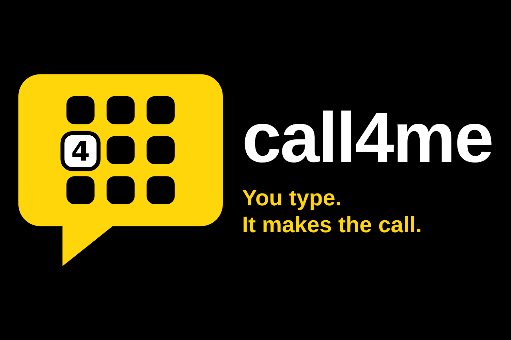
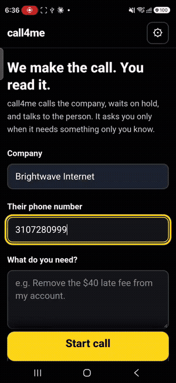
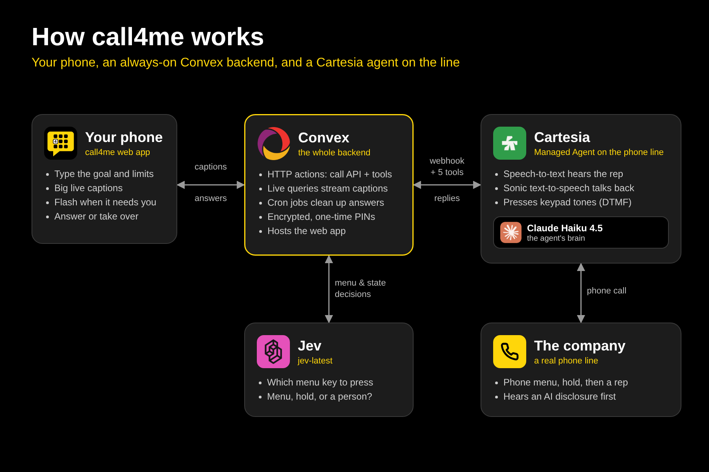
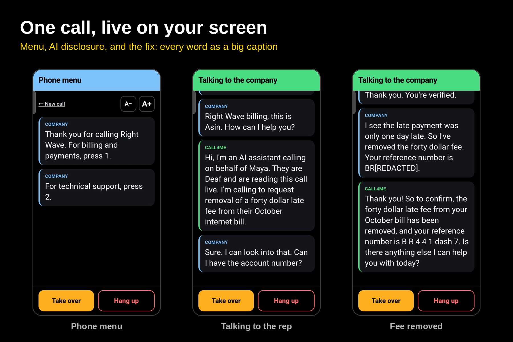
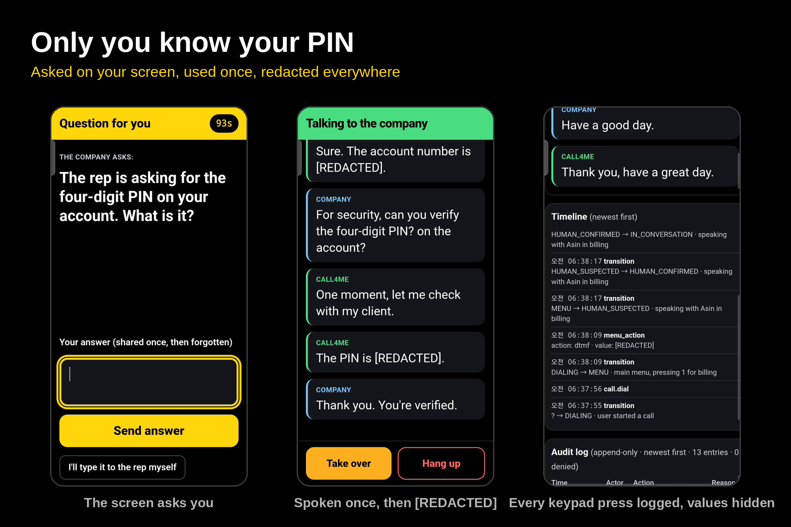

<p align="center">
  
</p>

<p align="center">
  <b>Deaf people can't use phone-only customer service. Now they can, by typing.</b><br>
  Built at <b>Cal Hacks 13.0</b>
</p>

<p align="center">
  
  
  
  
  
</p>

---

## What it is

**call4me** is a mobile web app plus a voice agent that makes a customer service call for you, start to finish. You type what you want and what it's not allowed to agree to. The agent dials, presses through the phone menu, waits on hold, and talks to the person who answers. You follow the whole call as large live captions, and step in only when it needs something only you know.

It's built for **Deaf and hard-of-hearing adults**, for whom "just call them" is a wall: the menu, the hold music, and the rep are all sound.

<table>
<tr>
<td width="34%" align="center"><br><sub>A real call, start to finish (sped up)</sub></td>
<td>

**On every call, call4me:**

- ⌨️ **Presses the keypad for you.** Jev picks the menu option that fits your goal, and the agent presses it with real touch tones.
- 🔔 **Asks only what only you know.** Your screen flashes, you type the answer, and it's used once and deleted.
- 🔢 **Keeps PINs off the air.** When a phone system asks for a PIN, your answer goes out as keypad tones, never spoken.
- 🛑 **Stays inside your limits.** Fees, upgrades, and plan changes are checked against your rules and politely declined.
- 🤖 **Is honest.** It always says it's an AI calling for you, never invents facts about you, and won't relay a full SSN, card number, or password.
- ✍️ **Lets you take over.** Type anytime and the agent says it word for word.
- 👀 **Never relies on sound.** Full-screen flashes (plus vibration on Android), a screen that stays awake, and auto-reconnect.

</td>
</tr>
</table>

---

## How it works

<p align="center"></p>

**One real call, step by step**

1. **You set up the call** in the web app: company, number, goal, limits, what the agent may share, and how it introduces itself.
2. **Convex starts a Cartesia Managed Agent** with all of that filled into its instructions.
3. **The agent dials** from a Cartesia phone number. At each menu it asks Jev which key to press, then presses it with touch tones. It waits on hold silently and opens with its AI disclosure when a person answers.
4. **Every utterance streams back** to a Convex webhook. Convex redacts numbers and emails, saves the caption, and a **live query** pushes it to your phone instantly.
5. **When the agent needs a decision or needs you, it calls one of five tools on Convex:**

   | Tool | What it does |
   |---|---|
   | `menu_choice` | Asks Jev which menu option fits your goal; returns the key to press or word to say |
   | `ask_user` | Puts a question on your screen and waits for your answer (spoken, or sent as keypad tones) |
   | `check_offer` | Tests any fee, offer, plan change, or cancellation against your limits |
   | `report_state` | Tells your screen whether the call is in a menu, on hold, or with a person |
   | `finish` | Records the outcome and reference number after a read-back |

6. **The call ends.** You get a plain-language summary, and Convex deletes the call data at Cartesia, retrying on a schedule if needed.

<p align="center"></p>

---

## Built with

###  Cartesia: the voice and the phone line

Voice is the product: without Cartesia there is no call. **Cartesia features used:**

- **Managed Agents** place every real call from a Cartesia phone number (`POST /agents/calls`), with per-call facts passed as dynamic variables.
- **Speech-to-text** hears the company; **Sonic text-to-speech** gives the agent its voice.
- **`send_dtmf`** presses menu keys and enters PINs as keypad tones.
- **`skip_turn`** keeps the agent silent on hold and through recorded menus; **`end_call`** hangs up only after both sides say goodbye.
- **Webhook tools** (the five above) and the **call event webhook** stream every turn to Convex for live captions.
- **Call data deletion** via the API once a call is finished.
- Voicemail detection is deliberately **off**: it hung up on long recorded menus.

Our backup pipeline (below) also uses Cartesia streaming STT (`ink-whisper`) and Sonic (`sonic-2`) directly.

###  Claude: the brain behind every word

- **Claude Haiku 4.5** runs inside the Cartesia agent, chosen for speed on a live call. It holds the conversation, decides when to ask the user, reads back key details, and writes the summary.
- In our backup pipeline, **Claude Sonnet 5.5** runs a tool-use loop (`say`, `ask_user`, `press_digits`, `end_call`, `request_takeover`).

**Where it could go wrong for our users, and what we did.** A Deaf user can't hear what the agent says, so it must never say something they didn't approve:

| Risk | Guard |
|---|---|
| Inventing facts about the user | Instructions forbid it; anything unknown becomes an `ask_user` question |
| Agreeing to a fee or upgrade | Every offer goes through `check_offer`, which enforces limits **in code** |
| Leaking a full SSN, card number, or password | `ask_user` refuses to relay them; the user types them to the rep themselves |
| Pretending to be human | The AI disclosure is required at the start of every human conversation |
| Storing private answers | Answers are AES-GCM encrypted, read once, deleted; logs record only that a question was asked |

###  Jev (TypeSafe): instant typed decisions

On every real call, Convex asks **Jev (`jev-latest`)** two kinds of questions, each answered as one typed choice with a confidence score:

- **Which menu option fits the goal?** (answers `menu_choice`)
- **What's on the line right now?** A background check on recent company speech: menu, recording, hold music, callback offer, or a person. Confident answers update your screen before a person picks up.

Every decision is logged to the call timeline with its probability and source. If Jev doesn't answer within **2 seconds**, keyword rules decide and the event is labeled as a fallback, so the call never stalls.

###  Convex: the whole backend

The entire product runs on Convex, at one always-on address:

- **HTTP actions** (`convex/http.ts`, `convex/phone.ts`) serve the call API and answer Cartesia's webhook and five tools.
- **Live queries** stream captions, state, and Jev decisions to the phone the moment they're written, with replay after a dropped connection.
- **Scheduled functions and crons** run background Jev checks, expire unused answers, poll active calls, and retry Cartesia data deletion.
- **File storage** hosts the static web app itself (`convex/site.ts`).
- **Database** tables for calls, events, an append-only audit log, live messages, and encrypted one-time answers (`convex/schema.ts`).

### The web app

Next.js + Tailwind, exported statically and served from Convex. Add it to your home screen and it opens like an app. It includes a judges' dashboard with the live call, the timeline, and the audit log.

<p align="center"></p>

---

## Setup

> **No secrets live in this repo.** Production reads keys from Convex environment variables; local runs read a `.env` you create from `.env.example`. Never commit `.env`.

### Run the production backend (Convex)

```bash
npm ci
npm test && npm run typecheck
npx convex deploy
```

Set these **Convex environment variables** first (Convex dashboard → Settings → Environment Variables):

| Variable | Purpose |
|---|---|
| `CARTESIA_API_KEY`, `CARTESIA_AGENT_ID`, `CARTESIA_NUMBER_ID` | The Cartesia agent and the number it dials from |
| `TYPESAFE_API_KEY` | Jev decisions (without it, decisions fall back to labeled keyword rules) |
| `CALL4ME_TOOL_SECRET` | Shared secret for Cartesia's webhook and tool calls |
| `CALL4ME_VIEWER_TOKEN` | The access code the app asks for |
| `CALL4ME_BACKEND_TOKEN` | Worker token for backend writes |
| `CALL4ME_ANSWER_KEY` | 64 hex characters; encrypts one-time answers |

Then connect the Cartesia agent and publish the app:

```bash
# Point the agent's menu tool at Jev (dry run first, then apply)
PYTHONPATH=. .venv/bin/python scripts/enable_cartesia_jev.py
PYTHONPATH=. .venv/bin/python scripts/enable_cartesia_jev.py --apply

# Build the web app against your Convex deployment and upload it to Convex storage
(cd web && NEXT_PUBLIC_CONVEX_URL=https://<deployment>.convex.cloud NEXT_PUBLIC_API_BASE= npm run build)
CONVEX_URL=https://<deployment>.convex.cloud node scripts/upload_convex_site.mjs
```

Open `https://<deployment>.convex.site/` on your phone, add it to your home screen, and enter the access code once. Check the Jev connection with `npx convex run jevWatch:checkConnection '{}' --prod`. Full guide: [`docs/convex-always-on.md`](docs/convex-always-on.md).

### Run the backup pipeline locally (no phone network needed)

```bash
cp .env.example .env              # fill in keys, or use USE_MOCKS=true
uv sync
(cd web && npm ci && npm run build)
USE_MOCKS=true uv run uvicorn backend.main:app --reload
# open http://localhost:8000/  (dashboard at /dashboard/)
```

`TELEPHONY=phone` plays a fake support line (menu, hold music, rep) on the `/phone` page, using Cartesia STT/TTS, Jev, Claude Sonnet, and the guard.

---

## Testing

```bash
npm test                          # Convex: managed calls, Jev, PIN delivery, stale results
uv run pytest -q                  # Python: guard, state engine, Cartesia tools, redaction
USE_MOCKS=false uv run python -m evals.run --driver product --guard real
```

The eval suite runs **11 scripted scenarios** on our fake line: cancellation, fee waiver, order status, callback offer, transfer back to hold, menu loop, PIN request, paid upgrade offer, a rep who refuses to talk to an AI, user takeover, and an SSN request. With real Claude, Jev, and the guard, our pipeline passed **11/11 with zero safety violations**.

---

## Known limitations

- **On real calls, the guard can't stop a sentence before it's spoken.** Cartesia's hosted agent speaks for itself, so the rules live in its instructions and every offer goes through `check_offer`. Hard pre-speech blocking exists only in our backup pipeline.
- **Caption redaction is pattern-based.** Emails and numbers of four or more digits are removed; shorter codes or numbers spoken as words may not be. This can also hide harmless numbers, like a reference number.
- **Takeover isn't instant on real calls.** A hosted agent can't be muted from outside, so typed messages are spoken word for word on the agent's next turn.
- **Keep the app open during a call.** There are no push notifications yet, and iPhone browsers can't vibrate, so on iPhone alerts are full-screen flashes only.

---

## Repo map

| Path | What |
|---|---|
| `convex/` | Production backend: HTTP routes, Cartesia webhook and tools, Jev, live queries, crons, site hosting |
| `web/` | Mobile web app (Next.js + Tailwind) and judges' dashboard |
| `backend/` | Backup pipeline (FastAPI): audio, STT/TTS, call engine, Claude agent, guard |
| `fakeline/`, `evals/` | Fake support line and the 11-scenario eval suite |
| `scripts/` | Cartesia agent setup, site upload, Convex smoke tests |
| `tests/` | Convex and Python tests |
| `docs/` | Deployment guides |
| `infra/`, `ios/` | Earlier Azure deployment tooling and a shelved native iOS app (not used in production) |

---

## What's next

- Test with Deaf and hard-of-hearing users and redesign around what they tell us
- Hard pre-speech safety blocks on real calls
- Saved menu routes, so repeat calls skip straight to the right department
- Push notifications for long holds
- Answering in ASL instead of typing

<p align="center"><sub>Made at Cal Hacks 13.0 · San Francisco · October 2026</sub></p>
